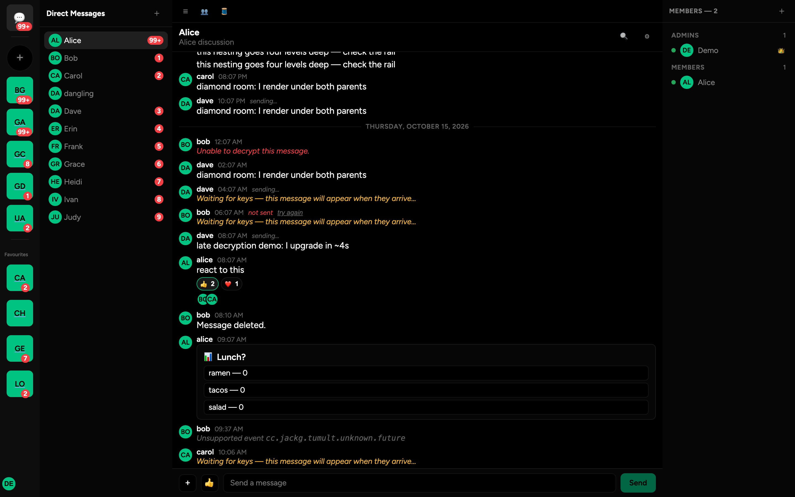
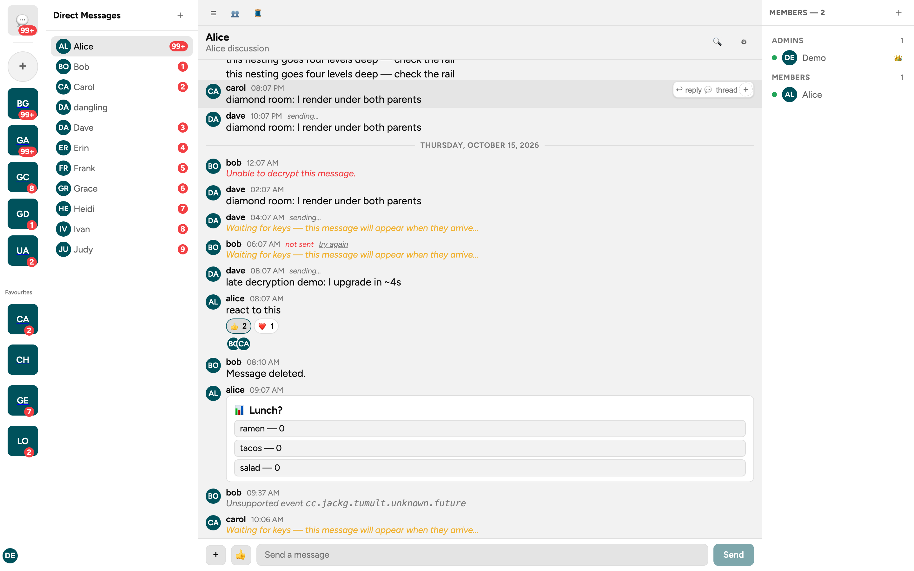
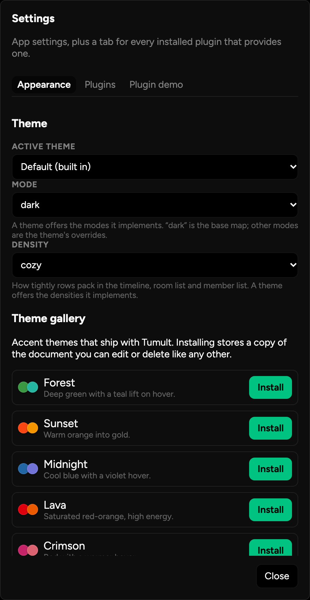
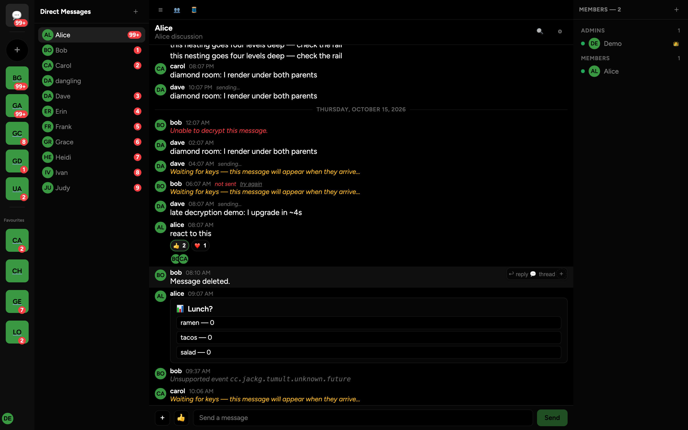
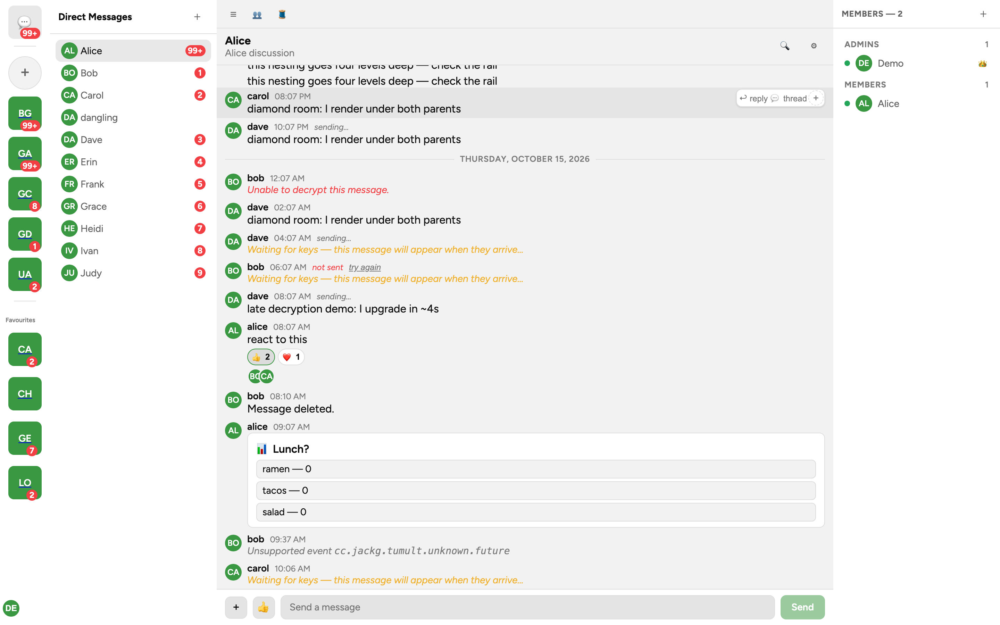
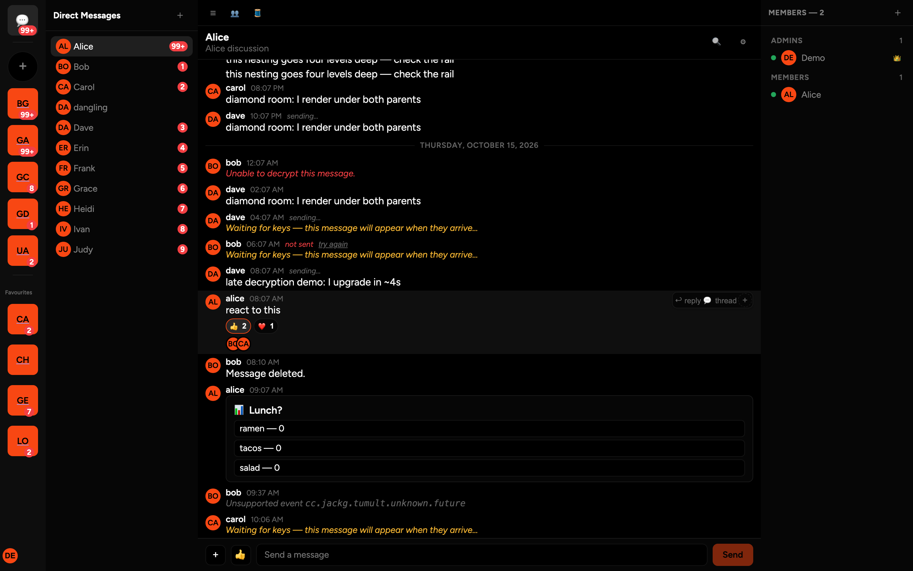
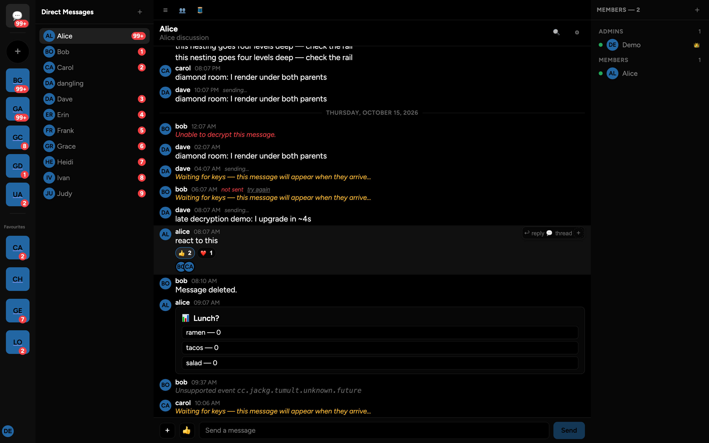
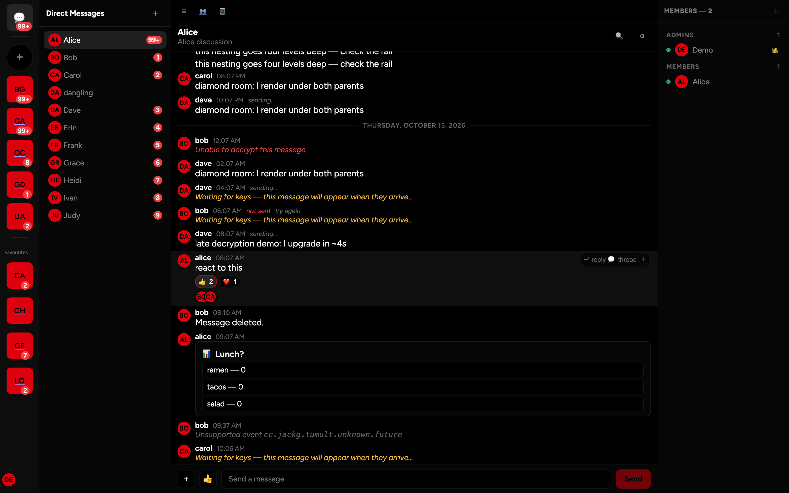
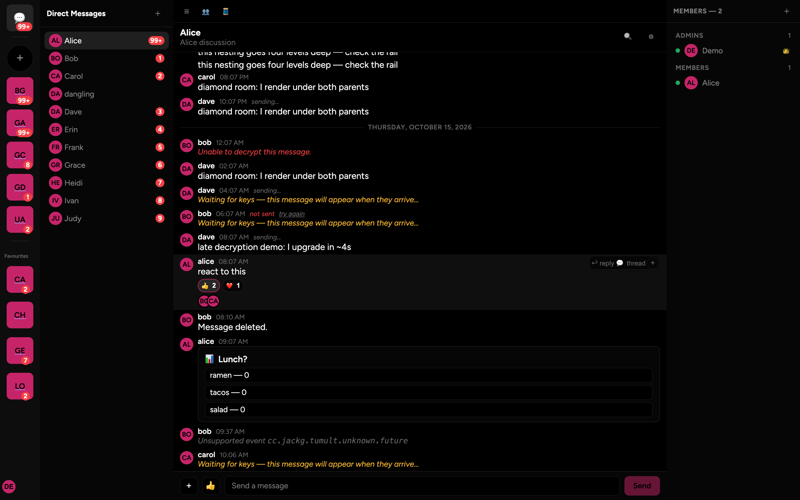

# Themes — documents, validation and the loader

Created: 2026-10-14
Scope: theme documents, validation and the loader. Companion to
`docs/tokens.md` (generated reference to all 273 tokens) and `docs/plugins.md`
(the sibling extension API).

## TL;DR

- A theme is a small **JSON document**: an envelope, a flat `tokens` map, and an
  optional set of per-mode override maps. Nothing else.
- It is **validated as a whole**. A document with any error is refused
  completely — no partial application, no half-styled app.
- Themes are **data, never code**. There is no remote loading, no URL, no
  `eval`, no user JS. The only opt-in escape hatch is raw CSS, which is a
  separate explicitly-enabled switch and is guarded (see §7).
- The built-in theme is `default` (`packages/theme/themes/default.json`,
  compiled at build time into `base.css` + `default.css`). Its name is reserved
  and cannot be replaced or shadowed by a user theme.
- A theme writes **only what it changes**; every token it omits inherits the
  **built-in document's** value (`packages/theme/themes/default.json`, which
  covers all 273 registry tokens — a missing one is a build error, not a silent
  blank).
- Five **accent themes** ship as data (`apps/web/public/themes/`) and are
  offered in the Appearance tab's gallery. They are sparse overlays — accent
  only — which is the clearest demonstration of the inheritance rule above (see
  §11).
- New to this? **[Authoring quickstart](#authoring-quickstart)** (build a theme in
  four steps) and the generated **[token reference](./tokens.md)** (every token
  with its type and built-in value). Reference for the envelope: §3.

## Screenshots

Captured from the built app in a real browser (Chromium, `mode fake`, 1440×900
@2x) by driving the actual install flow — not mocked. Each was validated
pixel-by-pixel: every accent shot paints ~108k pixels of *its own* theme's
accent colour and essentially none of the others.

The built-in theme, `default`:

| dark (the app default) | light |
|---|---|
|  |  |

The Appearance tab shows the gallery — title, blurb and swatch, no tokens until
you install one:



Installing an accent replaces only `accent` (and its hover); the surfaces, text,
radii and font all come from the built-in document:

| theme | dark | light |
|---|---|---|
| Forest |  |  |
| Sunset |  | |
| Midnight |  | |
| Lava |  | |
| Crimson |  | |

`accent-forest-light` is the regression witness for §5: *forest* declares a
`light` map, and the **surfaces** still flip because the built-in light values
are inherited. Before the attribute-presence fix in `emitBaseCss`, that shot
was black surfaces with a green accent.

## Authoring quickstart

A theme is **only the tokens it changes** — everything else is inherited from
the built-in document (§5), so the smallest useful theme is three keys:

1. **Write the document.** Save it as `<name>.json`:

   ```json
   {
     "$schema": "./theme.schema.json",
     "version": 2,
     "name": "my-theme",
     "tokens": { "accent": "#7aa2f7", "accent-hover": "#6b8fe0" }
   }
   ```

2. **Find token names** in the generated [`tokens.md`](./tokens.md) — it lists
   all 273 with their tier, kind and built-in value. Prefer a *semantic* role
   (`accent`, `surface-pane`, `danger`) over a primitive: overriding a primitive
   moves every role built on it (§2).

3. **Install it** from **Settings → Appearance**: paste the JSON into *Install a
   theme* or pick the file with the file button. It is validated on install, and
   a document with any **error** is refused whole — nothing half-applies (§4).
   The shipped accent themes can also be installed from the gallery with one
   click (§11).

4. **It applies immediately** and is stored in this browser only (§6). Switching
   theme or *Reset* returns to the built-in `default`; nothing is uploaded and
   no theme is ever fetched from a URL.

Live editing without saving is the editor's job: a sparse draft writes only the
tokens you change, previews on the document, and shows the issues while you
type (§8).

## 1. Where theming lives

| path | holds |
|---|---|
| `packages/theme/src/registry/` | the token registry: 273 `TokenDef`s (name, tier, kind, description; a structural `value` only where one exists) — **structure, no literal values** |
| `packages/theme/src/validate/` | the hand-rolled validator (envelope, names, values, references, tiers, cycles) |
| `packages/theme/src/emit/` | registry → CSS: `base.css`, a theme's override block, serialization |
| `packages/theme/src/loader.ts` | `loadTheme` / `loadThemeText` — untrusted document in, validated document + CSS (or a refusal) out |
| `packages/theme/src/store.ts` | `ThemeStore` — persistence, selection, modes, advanced CSS; the **only writer** of the persisted state |
| `packages/theme/src/runtime.ts` | the registry-free half: persisted shape, readers, boot helpers, the CSS guard (`@tumult/theme/runtime`) |
| `packages/theme/src/css-guard.ts` | `findExternalStylesheetReferences` — the shared refusal rule for injected CSS |
| `packages/theme/src/build/` | node-only build: `compile.ts` (themes → `dist/themes/*.css`), `emit-docs.ts`, and `cli.ts` — the single entry that runs both, so compiling also regenerates the authored docs |
| `packages/theme/themes/default.json` | the built-in theme's **values**: all 273 tokens + the `light` mode and `compact`/`spacious` density maps. This is the inheritance base an installed theme overlays |
| `docs/tokens.md` | **generated** token reference (kind, built-in value, description per token) — the list to author against; rebuilt by the theme build, guarded by `test/docs.test.ts` |
| `docs/theme.schema.json` | **generated** JSON Schema for the envelope — point a theme document's `$schema` at it for editor completion |
| `apps/web/src/theme/apply.ts` | DOM application: `data-theme` / `data-mode` / `data-density` and the ordered `<style>` slots |
| `apps/web/src/theme/controller.ts` | the app's `ThemeControls` implementation (store + DOM + a reactive snapshot, plus the gallery fetch) |
| `apps/web/public/themes/` | the shipped accent **gallery** as data: `index.json` (title/blurb/swatch only) + one document per theme |
| `packages/ui/src/settings/AppearanceTab.vue` | the UI: select/install/edit/reset, the gallery, advanced CSS |
| `packages/ui/src/settings/ThemeEditor.vue` | the token-tree editor with live preview |
| `packages/ui/src/theme/controls.ts` | the `ThemeControls` / `ThemeKey` seam between the two |
| `apps/web/public/fonts/` | self-hosted Figtree (the family `font-sans` names) + `OFL.txt` |

The split matters: `packages/ui` never touches storage or the document element,
and `apps/web` never renders a token row. `main.ts`'s boot path imports only
`@tumult/theme/runtime` (registry-free) so the ~50 kB registry and validator
stay out of the entry chunk.

## 2. The token contract in one page

Tokens are CSS custom properties. In a document you write them **without the
leading `--`**; in CSS you read them with it (`var(--accent)`).

Three tiers, and references flow one way:

```
primitives  (palette + raw scales)   →   semantic  (roles: surface/text/accent/…)   →   component  (dialog-*, timeline-*)
```

- a **primitive** may reference only primitives;
- a **semantic** token may reference primitives and other semantic tokens, never
  a component token;
- a **component** token may reference semantic and component tokens, never a
  primitive directly (go through a role).

A theme may override **any tier** — primitives included — but overriding a
primitive is the broadest possible edit (every role built on it moves). The
narrowest useful edit is the semantic role you actually care about.

Kinds: `color`, `spacing`, `radius`, `typography`, `motion`, `layout`, `size`,
`shadow`, `z-index`, `line-height`, `letter-spacing`, `font-weight`,
`border-width`, `opacity`. Each kind has a value grammar; a value containing
`var(--…)` is treated as a reference and checked as one.

Two house rules worth internalising:

1. **Roles must be consumed; scales may not.** Every component token and every
   semantic *role* has to be referenced by something or it is dead weight
   (asserted by `packages/theme/test/coverage.test.ts`). Scale rungs ship
   complete even when unused, and primitives are a palette — unused rungs are
   expected.
2. **The UI may not inline raw values.** No hex/rgb/hsl, no `px`/`rem` in
   component styles; `50%` circles use `var(--radius-full)`. This is enforced
   mechanically over every `.vue` `<style>` block.

The registry is the source of truth for **structure**: read
`packages/theme/src/registry/` for the exact name, tier, kind and description of
any token. Values are not there — the built-in theme's values live in
`packages/theme/themes/default.json` (see §5), and the editor's token tree shows
the effective built-in value as each field's placeholder.

## 3. A theme document

```json
{
  "version": 2,
  "name": "my-theme",
  "tokens": { "accent": "#7aa2f7", "accent-hover": "#6b8fe0" },
  "modes": { "light": { "surface-base": "var(--prim-neutral-9)" } }
}
```

| field | required | rules |
|---|---|---|
| `version` | yes | contract version; `1` and `2` are understood today. Anything else is a **warning**, not an error — an unknown version means "this build may not know every token", which is a forward-compatibility signal rather than a broken file. |
| `name` | yes | `^[A-Za-z0-9][A-Za-z0-9._-]{0,63}$` — it becomes the `data-theme` value inside a selector, so a name that could close `:root[data-theme="…"]` is an error. `default` is **reserved** (see §6). |
| `tokens` | yes | flat map of token name → value. Unknown names are **errors** with a did-you-mean suggestion, because CSS silently drops a token that does not exist. |
| `modes` | no | map of mode name → partial token map. Mode keys match `^[A-Za-z0-9-]{1,32}$`. |
| `densities` | no | map of density name → partial token map, same rules and same key grammar as `modes`. Emitted after the modes, so a density wins a tie. Base density `cozy` means *no attribute*. |

### Authoring aids

Both are **generated by the theme build** (`pnpm --filter @tumult/theme build`,
which also compiles the CSS) and committed so they render on GitHub; the test
(`packages/theme/test/docs.test.ts`) fails if either drifts from the builders,
so they cannot document a token that no longer exists.

| file | what it gives you |
|---|---|
| [`tokens.md`](./tokens.md) | every token — kind, **built-in value** and description — grouped by tier. This is the list to pick names from. |
| [`theme.schema.json`](./theme.schema.json) | JSON Schema for the envelope (in the repo at `docs/theme.schema.json`, next to this file). Point your document at it — copy it beside your `.json`, or use a path relative to wherever you save it — and your editor completes token names and flags typos: |

```json
{
  "$schema": "./theme.schema.json",
  "version": 2,
  "name": "my-theme",
  "tokens": { "accent": "#7aa2f7" }
}
```

`$schema` is not part of the contract — the validator reads only `version`,
`name`, `tokens`, `modes` and `densities`, so an editor hint is ignored (it is
dropped when the app re-serializes a saved theme).

### Modes

A mode is a `data-mode` value. `dark` is special: it is the **base mode** and
means *no attribute at all*, so a theme's base `tokens` map **is** dark. Every
other mode is an override block emitted after the base:

```css
:root[data-theme="my-theme"] { /* tokens */ }
:root[data-theme="my-theme"][data-mode="light"] { /* modes.light */ }
```

Consequences worth knowing:

- Don't write a `modes.dark` block. It is accepted and valid, but `data-mode`
  is never set to `dark`, so it can never apply.
- A mode map is an **override** map: a token it omits is not reported (unlike
  the base map, where a missing token is an `info` — "the built-in theme's value
  applies").
- A theme declares its own modes. The app offers exactly what the active theme
  implements, and switching themes re-checks the current mode — a mode the new
  theme does not implement falls back to dark instead of showing a label that
  lies.
- If you want `light` to mean anything, override the **semantic** roles
  (surfaces, text, borders) as `default.json` does. Overriding only primitives
  means a light label with a dark palette.

### Densities

A density is the same mechanism on `data-density` (`cozy` = base = no
attribute; the built-in theme offers `compact` and `spacious`). Density blocks
are emitted after the mode blocks so they win a same-specificity tie, and the
virtualizers carry a per-density pixel delta — they *estimate* row height in TS
and re-measure rendered rows, so the CSS stays the source of truth.

### Examples

Smallest useful theme — retune the brand colour, inherit everything else:

```json
{ "version": 2, "name": "ocean", "tokens": { "accent": "#3d7dd8" } }
```

A dark/light pair (semantic overrides only):

```json
{
  "version": 2,
  "name": "paper",
  "tokens": {
    "surface-base": "var(--prim-neutral-7)",
    "text-primary": "var(--prim-neutral-0)"
  },
  "modes": {
    "light": {
      "surface-base": "var(--prim-neutral-9)",
      "text-primary": "var(--prim-neutral-7)"
    }
  }
}
```

A denser UI (spacing + type scale):

```json
{
  "version": 2,
  "name": "compact",
  "tokens": { "space-2": "3px", "radius-md": "6px", "text-sm": "0.82rem" }
}
```

## 4. Validation, and what "refused" means

`loadTheme(input)` / `loadThemeText(text)` never throw. They return:

```ts
interface LoadedTheme {
    name: string;              // "" when the document had no usable name
    json: ThemeJson;           // normalized — safe to edit, export and reload
    validation: ValidationResult;
    css: string | null;        // null ⟺ the document has errors
}
```

**`css === null` is the whole contract.** Nothing may be injected for a refused
document; callers key off that one field rather than re-deriving the rule.
A refused document still returns its normalized `json` and its issues, so an
editor can open it and explain the refusal.

Issue codes (`packages/theme/src/validate/issues.ts`):

| code | severity | meaning |
|---|---|---|
| `invalid-envelope` | error | not an object / missing or non-string `name` / unparseable JSON (paste path) |
| `invalid-name` | error | name fails the selector-safe rule; also the reserved-name refusal from the store |
| `invalid-mode` | error | a `modes.*` key fails the selector-safe rule |
| `unknown-token` | error | a token name that is not in the registry |
| `unknown-reference` | error | a `var(--…)` pointing at a token that does not exist |
| `tier-violation` | error | a reference that goes the wrong way across tiers |
| `reference-cycle` | error | `a → b → a` in one scope |
| `invalid-value` | error | the value does not match its token's kind |
| `unsafe-value` | error | the value can escape its CSS declaration (`;`, `{`, `}`, `@`, `<`, `>`, backtick, control chars, `/*`). Reported alone — every other check would only pile on. |
| `banned-url` | error | the value contains `url()`. Token values are values, not URLs; an image in a theme is not a thing this contract supports. |
| `missing-token` | info | (base map only) the token is not set, so the structural default applies |
| `unsupported-version` | warning | the version is not one this build knows |

Only `error` blocks a theme. Warnings and infos are advisory and are shown as
notes. The `unsafe-value` and `invalid-name`/`invalid-mode` checks exist because
a theme document is **untrusted input**: it must not be able to close its own
declaration or its own selector.

## 5. How a theme reaches the document

Three dataset attributes plus three ordered `<style>` slots:

```
data-theme="my-theme"        scopes the theme's emitted CSS
data-mode="light"            selects a mode override block (absent = dark)
data-density="compact"       selects a density override block (absent = cozy)

<style data-tumult-theme="active">    the stored theme's emitted CSS
<style data-tumult-theme="preview">   an unsaved draft from the editor
<style data-tumult-theme="advanced">  the user's raw advanced CSS (opt-in)
```

Later slots win, and the slots are re-appended in that order on every change so
the cascade never depends on insertion timing. The theme's CSS is scoped to the
`data-theme` value, so only one theme is ever live; the built-in `default` theme
is just another value of the attribute.

### The built-in document is the inheritance base

`emitBaseCss` (build time) writes the built-in **tokens** to `:root` *and* its
`modes` / `densities` maps to the **attribute-presence** selectors
`:root[data-theme][data-mode="light"]` and
`:root[data-theme][data-density="…"]` — not to `[data-theme="default"]`. That
matters because an installed theme is *sparse*: it usually declares no
`light` map at all, so without the inherited block installing an accent would
drop light mode (black surfaces under a green accent).

The presence attribute is load-bearing for the cascade:

| selector | specificity | role |
|---|---|---|
| `:root[data-theme][data-mode="light"]` (built-in sheet) | 0,2,1 | inherited light values |
| `:root[data-theme="x"]` (an installed theme's base block) | 0,1,1 | a theme's dark values |
| `:root[data-theme="x"][data-mode="light"]` (the theme's own map) | 0,2,1 | ties the inherited block, wins on order |

So a theme's own `light` map overrides the built-in one, a built-in light value
can never bleed into a theme's dark mode, and a theme that says nothing still
gets a working light mode. Density blocks are emitted last, so they win a
same-specificity tie with a mode.

Boot (`apps/web/src/theme/apply.ts`, called from `main.ts` **before mount**)
applies the **cached** CSS straight from storage, without touching the registry
or the validator, so the first paint is already in the user's theme and the
entry chunk stays small. Re-validation is unnecessary because `ThemeStore` — the
only writer — refuses to persist a document that did not pass validation, and
the boot path additionally re-checks the name and re-runs the CSS guard in case
the storage key was hand-edited.

The live controller (`apps/web/src/theme/controller.ts`) re-applies the same
slots on every change: `select`/`setMode`/`install`/`remove`/`reset` write the
theme slot, `preview` writes the preview slot, `setAdvancedCss` writes the
advanced slot. Everything it exposes is a synchronous call over a
`shallowRef<ThemeState>` snapshot, so the UI just renders state.

`data-theme` and `data-mode` are set on `document.documentElement`;
`apps/web/index.html` ships `data-theme="default"` so the very first frame (which
is the *pre-theme* login surface) already reads from the built-in theme.

## 6. Storage

One localStorage key holds everything — one read at boot:

```jsonc
// tumult.themes
{
  "version": 1,
  "themes": [ { "name": "my-theme", "json": { /* … */ }, "css": "/* cached emission */" } ],
  "active": "my-theme",      // or "default"
  "mode": "dark",            // "dark" means no data-mode attribute
  "advancedCss": ""          // raw CSS, opt-in
}
```

The cached `css` is a **boot fast path**, not the source of truth: `ThemeStore`
writes it from a validated document, and the boot path applies it verbatim.
`ThemeStore` re-validates and re-emits each stored document when it loads, so a
stale cache (an older registry, a hand-edited document) is repaired in place on
the next write.

Degradation is deliberate and one-directional: malformed JSON, a non-object
payload, an unusable stored name, or a stored theme with no emission all fall
back to the built-in theme rather than breaking boot. Entries that are malformed
are **kept** in the list — the UI needs something to show and let the user
delete, and silently dropping a user's theme is worse than listing a broken one.

The store enforces the rest:

- `default` is refused as a name (its CSS is compiled at build time; two
  `:root[data-theme="default"]` blocks would be indistinguishable).
- A document with errors is refused whole (`save` returns the issues, nothing is
  written).
- `select` only accepts the built-in theme or a stored theme that has an
  emission.
- A mode is normalised against the active theme (see §3), on both `save` and
  `select`.
- `setAdvancedCss` runs the CSS guard (§7) before storing.
- `reset()` clears themes, advanced CSS and the mode.

There is **no sync**: themes are per-browser. `packages/ui` never reads storage;
the app owns it.

## 7. Advanced CSS

The JSON path cannot express everything (a one-off tweak, a property with no
token, an experiment). Advanced CSS is the explicit escape hatch:

- It is off by default and enabled by a checkbox in **Settings → Appearance**.
- It is applied *after* every theme slot, so it wins the cascade.
- It is guarded exactly like a plugin stylesheet: `@import` and any `url()` that
  is not `data:`, `blob:` or a same-document `#fragment` are **refused** with an
  error naming the offending declaration. A remote reference under production
  CSP (`style-src 'self'`) would otherwise fail *silently*, and a silent
  third-party request from CSS the app cannot audit is exactly what the guard is
  for.
- Turning the checkbox off clears the stored CSS immediately, not on the next
  Apply.

It is deliberately **not scoped** (the shell has no shadow root), so advanced CSS
can restyle anything in the app — that is the point, and the warning in the UI
says so. A plugin stylesheet and advanced CSS are at the same trust level: code
the user chose to run. (A plugin injects one through `ctx.injectStylesheet()` —
the same guard, the same rule; see `docs/plugins.md` §5.6.)

Production CSP is still an open question: the dev
policy is `style-src 'self' 'unsafe-inline'`, and a shipped header is the
recommended delivery. Advanced CSS depends on that decision — a nonce-based
policy would need the injected `<style>` elements to carry the nonce.

## 8. Using the API

Two entry points, on purpose:

```ts
// Full surface — registry, validator, loader, store. Pulls ~50 kB.
import { ThemeStore, loadTheme, loadThemeText, validateTheme, ALL_TOKENS } from "@tumult/theme";

// Registry-free runtime — persisted shape, boot helpers, the CSS guard.
// Import this from a boot path (`main.ts`) so the registry stays out of the entry chunk.
import { readThemeState, activeThemeName, activeThemeCss, findExternalStylesheetReferences } from "@tumult/theme/runtime";
```

For the UI ↔ app seam, `packages/ui` exports `ThemeKey`, `useTheme()`,
`tryUseTheme()` and the `ThemeControls`/`ThemeState` types. The app provides an
implementation above the shell (see `apps/web/src/theme/controller.ts`); the
shell registers the Appearance tab **only** when one is present. A host that
renders `TumultShell` without a theme controller gets no Appearance tab — there
is nothing for it to manage — and that is a supported configuration.

`ThemeEditor.vue` edits a **draft**: it starts sparse (an omitted token shows the
built-in theme's value as a placeholder and is simply inherited), `preview()`
applies it to the document without storing anything, `install()` is Save, and
Cancel or unmounting calls `endPreview()`. An invalid draft keeps the last valid preview
applied and shows the issues — typing into a hex field never blanks the app.

## 9. Migrating a v1 theme

Short version: change `version` to `2`, add a `name` if you have not, and ship
it. The v1 → v2 delta, in brief:

- Every v1 token still exists except the never-referenced `shell-gap`.
- There are **no renames**.
- `version: 1` is still accepted (as an `unsupported-version` warning), so an
  untouched v1 theme keeps working; bumping to `2` silences the note.
- `modes` is new and optional.
- Two defaults moved for consistency: `timeline-row-gap` now resolves to
  `var(--space-2)`, and danger buttons darken on hover like primary ones. A
  theme that sets those tokens itself is unaffected.

## 10. Verifying a theme

```sh
pnpm --filter @tumult/theme build    # compiles themes/*.json -> dist/themes/*.css AND regenerates docs/tokens.md + docs/theme.schema.json
pnpm --filter @tumult/theme test     # validator + loader + store + coverage + default drift + the generated-docs guard
pnpm --filter @tumult/ui test        # color helpers used by the editor
pnpm --filter @tumult/web test:browser   # the whole loader/UX flow in a real browser
```

The theme build writes the authored reference docs as well as the CSS: if you
change the registry or a built-in value, run the build and commit
`docs/tokens.md` and `docs/theme.schema.json`. `test/docs.test.ts` re-renders
both and fails on any drift, so a stale reference cannot be merged.

Or programmatically:

```ts
import { loadThemeText } from "@tumult/theme";

const loaded = loadThemeText(jsonText);
if (loaded.css === null) {
    for (const issue of loaded.validation.issues) console.error(issue.code, issue.message, issue.suggestion);
} else {
    console.log(loaded.css); // exactly what the app would inject
}
```

## 11. The shipped gallery

Five accent themes ship **as data** in `apps/web/public/themes/`:

```
index.json         [{ id, title, description, swatch: [accent, hover] }, …]
forest.json        one document per id — a sparse overlay (see below)
sunset.json
midnight.json
lava.json
crimson.json
```

The index carries **no tokens**, only presentation: `AppearanceTab` can render
every row (title, blurb, swatch chips) before a single document is fetched, and
the documents are fetched one at a time, on install. A gallery document is a
deliberately tiny overlay — `accent` + `accent-hover`, in the base map *and* in
`modes.light` — so it is the concrete illustration of §5's inheritance base:
everything else (surfaces, text, radii, the font) comes from the built-in
document.

The UI never fetches. The seam is on `ThemeControls`:

```ts
readonly gallery: Ref<ThemeGalleryEntry[]>;      // empty until loadGallery resolves
loadGallery(): Promise<void>;                    // idempotent; failure leaves it empty
installGallery(id: string): Promise<void>;       // fetch one document + install it
```

`apps/web/src/theme/controller.ts` owns the fetches (same-origin, static), so
`@tumult/ui` stays free of network access and a host that provides its own
controller simply has no gallery. `packages/theme/test/gallery.test.ts` pins the
index against the documents against the validator: every advertised id exists,
its document validates, and its name matches the id.

To add one: drop `public/themes/<id>.json` and an `index.json` entry — no code.

## 12. Deliberately not supported

- **Remote themes.** No URL, no registry, no auto-update. Themes are pasted or
  imported from a local file. (The shipped gallery in §11 is same-origin app
  data fetched by the app's own controller, not a theme registry a user can
  point at.)
- **JavaScript.** No scripts, no templating, no computed values. Where the
  token contract does not reach, advanced CSS does.
- **Fonts and images.** Token values reject `url()` outright, and advanced CSS
  accepts only `data:`/`blob:` references — so a theme cannot phone home. Load
  fonts your own way; a theme can name a family (`font-sans`) but not a source.
- **Per-room or per-space themes.** One theme per document.
- **Sync.** Themes live in this browser's localStorage.
- **Auto light/dark** from `prefers-color-scheme`. Modes are an explicit choice;
  wiring a media-query hook is a small future addition to the controller, not a
  change to the document format.
